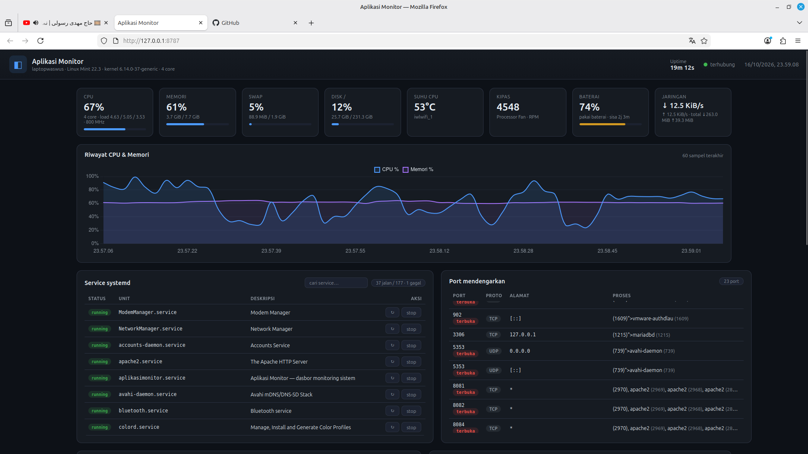

# Aplikasi Monitor

Dasbor monitoring untuk laptop Linux: **service systemd**, **aplikasi/proses**,
**port yang mendengarkan**, **resource** (CPU/RAM/disk/jaringan), **sensor** (suhu,
kipas, baterai), dan **log journald realtime** — semuanya di satu halaman web.

Stack: **FastAPI + psutil** di backend, frontend HTML/CSS/JS ringan dengan Chart.js.
Tanpa database; semua data dibaca langsung dari sistem.



## Fitur

- **Ringkasan live** — CPU, memori, swap, disk, suhu, kipas, baterai, trafik jaringan
  (dorong lewat SSE setiap 2 detik).
- **Grafik riwayat** CPU & memori (60 sampel terakhir).
- **Service systemd** — daftar lengkap + status, tombol `start` / `stop` / `restart`,
  pencarian instan.
- **Port mendengarkan** — dari `ss`, ditandai mana yang terekspos ke jaringan.
- **Proses teratas** — dapat diurut CPU/RAM, lengkap dengan user dan RSS.
- **Sensor lm-sensors** — suhu/kipas/tegangan lengkap dengan nilai maks & kritis.
- **Log journald LIVE** — stream `journalctl -f`, filter per unit dan level.

## Menjalankan

```bash
./setup.sh     # sekali saja: paket sistem + virtualenv + pasang paket (editable)
./run.sh       # jalankan server
```

Buka **http://127.0.0.1:8787**

Tanpa `./run.sh`, perintahnya sama dengan:

```bash
.venv/bin/aplikasimonitor                 # atau
.venv/bin/python -m aplikasimonitor
```

## Struktur

```
aplikasimonitor/            # paket Python
  cli.py                    # entry point CLI (`aplikasimonitor`)
  main.py                   # API FastAPI + SSE, menyajikan frontend
  config.py                 # konfigurasi via environment variable
  service_control.py        # kontrol service lewat D-Bus/polkit (fallback: systemctl)
  collectors/
    system.py               # info host
    resources.py            # cpu, memori, disk, jaringan, baterai, suhu, fan
    services.py             # systemctl list-units --output=json
    processes.py            # daftar proses (psutil)
    ports.py                # parsing `ss -tulpnH`
    sensors.py              # parsing `sensors -j` (lm-sensors)
    logs.py                 # stream `journalctl -f -o json` (async)
  static/                   # berkas antarmuka (package data)
pyproject.toml              # metadata + dependensi + entry point
packaging/                  # unit systemd --user untuk pemasangan manual
debian/                     # berkas pengemasan .deb
man/                        # manpage
```

## Endpoint API

| Method | Path | Keterangan |
|---|---|---|
| GET  | `/api/host` | info host & uptime |
| GET  | `/api/resources` | CPU, memori, disk, jaringan, baterai, suhu |
| GET  | `/api/stream` | **SSE** snapshot resource tiap 2 detik |
| GET  | `/api/services` | daftar service systemd + ringkasan |
| POST | `/api/services/{unit}/{action}` | `start` \| `stop` \| `restart` \| `reload` |
| GET  | `/api/processes?sort=cpu&limit=50` | daftar proses |
| GET  | `/api/ports` | port mendengarkan |
| GET  | `/api/sensors` | pembacaan lm-sensors |
| GET  | `/api/logs/stream?unit=&lines=50&priority=` | **SSE** log journald |

## Kontrol service: D-Bus + polkit (tanpa sudo)

Aksi `start`/`stop`/`restart` dikirim ke systemd lewat **API D-Bus**
(`org.freedesktop.systemd1.Manager`). Otorisasi ditangani **polkit**, sehingga:

- aplikasi berjalan **tanpa hak istimewa** dan **tanpa aturan `sudoers`**;
- bila perlu, desktop memunculkan dialog izin seperti aplikasi bawaan lainnya;
- `auth_admin_keep` membuat izin diingat sesaat setelah sekali disetujui.

Karena itu disarankan menjalankannya **di dalam sesi desktop** (mis. sebagai unit
`systemd --user`, lihat `packaging/aplikasimonitor.service`) agar agen polkit dapat
memunculkan dialog.

Jalur cadangan `systemctl` tetap tersedia:

```bash
MONITOR_SERVICE_BACKEND=systemctl MONITOR_SUDO=1 ./run.sh   # butuh sudo tanpa password
```

`MONITOR_SUDO=1` mengawali `systemctl` dengan `sudo -n`; pilihan ini hanya untuk
keadaan khusus dan **tidak disarankan** untuk paket distribusi.

## Konfigurasi (environment variable)

| Variabel | Default | Fungsi |
|---|---|---|
| `MONITOR_HOST` | `127.0.0.1` | alamat bind (pakai `0.0.0.0` untuk akses LAN) |
| `MONITOR_PORT` | `8787` | port |
| `MONITOR_STREAM_INTERVAL` | `2` | interval push SSE (detik) |
| `MONITOR_SERVICE_CONTROL` | `1` | aktifkan aksi start/stop/restart |
| `MONITOR_SERVICE_BACKEND` | `auto` | `auto` \| `dbus` \| `systemctl` |
| `MONITOR_SUDO` | `0` | hanya untuk jalur `systemctl`: awali dengan `sudo -n` |

Pilihan baris perintah: `aplikasimonitor --host --port --interval --no-service-control
--reload --version`.

## Distribusi

### Pasang dengan pipx (paling sederhana)

```bash
pipx install .              # dari salinan lokal
pipx install '.[dbus]'      # sekaligus sertakan dbus-next untuk kontrol service
```

### Bangun paket .deb

Berkas pengemasan sudah tersedia di `debian/` (format native, `dh-python` + `pybuild`).

```bash
sudo apt install debhelper dh-python pybuild-plugin-pyproject \
                 python3-all python3-setuptools lintian
dpkg-buildpackage -us -uc -b          # hasilkan .deb di direktori induk
lintian ../aplikasimonitor_0.1.0_all.deb
sudo apt install ../aplikasimonitor_0.1.0_all.deb
```

Paket `.deb` sengaja **bergantung pada paket Python resmi distro**
(`python3-fastapi`, `python3-uvicorn`, `python3-psutil`, `python3-dbus-next`)
alih-alih mem-bundle pip — ini syarat agar sebuah paket layak masuk repositori.

> Catatan: berkas pengemasan ini belum diuji end-to-end. Untuk dikirim ke
> Debian/Ubuntu, ganti `debian/source/format` menjadi `3.0 (quilt)` dan sediakan
> `orig.tar.gz`.

### Rilis otomatis lewat GitHub Actions

`.github/workflows/release.yml` membangun `.deb` lalu menerbitkannya sebagai
GitHub Release dan artifact:

| Pemicu | Nomor versi | Hasil |
|---|---|---|
| push ke `master` | patch naik otomatis dari tag terakhir (`v0.1.0` → `v0.1.1` → …) | tag baru + Release baru |
| push tag `v*` | diambil dari tag tersebut | Release untuk tag itu — untuk rilis minor/mayor |
| **Run workflow** di tab Actions | boleh diisi manual, mis. `0.2.0` | tag + Release |

Nomor versi ditulis ke `pyproject.toml` dan disisipkan sebagai entri baru di
`debian/changelog` sebelum build, jadi `.deb` selalu bernama sesuai versinya.
Workflow ini idempoten: menjalankannya ulang pada commit yang sama tidak membuat
tag atau entri changelog kembar.

Untuk rilis minor/mayor, cukup buat tag sendiri:

```bash
git tag v0.2.0 && git push origin v0.2.0
```

> Karena `debian/source/format` = `3.0 (native)`, nomor versi tidak boleh
> mengandung tanda hubung. Tag seperti `v1.0.0-rc1` akan ditolak dengan pesan
> jelas — pakai `1.0.0`.

### Jalur ke repositori resmi Debian/Ubuntu

1. Ajukan bug **ITP** di `bugs.debian.org`.
2. Cari **sponsor** di `debian-mentors`; hosting di `salsa.debian.org`.
3. Syarat: `lintian` bersih, `debian/copyright` format DEP-5, manpage, autopkgtest,
   build reproducible.
4. Setelah masuk Debian, paket tersinkron ke Ubuntu `universe`.

## Catatan

- **Log journald** bisa dibaca tanpa `sudo` bila user tergabung di grup `adm` atau
  `systemd-journal`. Kalau log kosong: `sudo usermod -aG systemd-journal $USER`
  (perlu login ulang).
- **Chart.js** dimuat dari CDN; tanpa internet grafik tidak muncul (sisa dasbor tetap
  jalan). Untuk offline, unduh `chart.umd.min.js` ke `aplikasimonitor/static/` lalu
  ubah `<script src>` di `index.html`.
- Aplikasi bersifat **read-only terhadap sistem**, kecuali tombol aksi service.
- Rencana lanjutan: lihat [`CATATAN-LANJUTAN.md`](CATATAN-LANJUTAN.md).
